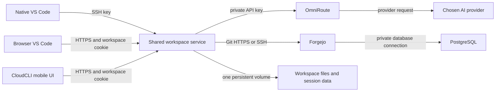

# CloudDev AI: Sovereign Workspace

CloudDev AI is a single-user development workspace built around one shared
remote filesystem. Native VS Code Remote-SSH, browser VS Code, and the
CloudCLI mobile interface connect to the same Railway service, project files,
Git configuration, and provider session artifacts.

This is not a multi-tenant service. Every operator deploys an isolated copy to
their own Railway project. The product does not promise matching editor-window
state across clients. It shares files and only the agent history supported by
the upstream provider.

> Status: implementation is in progress. Local checks, fresh Railway
> deployment, iPhone/Windows acceptance, Marketplace publication, and restore
> drills are reported separately in [GATES.md](GATES.md). Do not describe this
> template as one-click verified until the fresh-project Railway test passes.
>
> Release hold: the pinned OmniRoute image still has unresolved high/critical
> advisories. Keep the dashboard and inference endpoints private until G15 and
> G17 are closed on the exact release images.

The documentation source is in [`docs/`](docs/index.md). GitHub Pages is
configured for Actions publishing. The public link will be added after the first
deployment is verified.

## Architecture



Railway services:

- `clouddev-ide`: code-server, CloudCLI, Codex CLI, Claude Code CLI, Caddy,
  key-only OpenSSH, and the small authenticated launchpad.
- `clouddev-git`: rootless Forgejo with registration disabled and its own
  optional built-in Git SSH listener.
- `clouddev-postgres`: managed PostgreSQL with no public domain.
- `clouddev-router`: pinned OmniRoute with a persistent encrypted SQLite
  database.

CloudCLI is at the workspace root. Browser VS Code is under `/vscode/`, the
launchpad is under `/launchpad/`, and the OmniRoute dashboard is under
`/omniroute/`. Caddy checks a signed, HttpOnly workspace cookie through the
launchpad before proxying browser requests. This leaves the `Authorization`
header free for CloudCLI's own Bearer token. The dashboard then uses
OmniRoute's native sign-in. A loopback-only adapter in the workspace routes
CLI health checks to the private dashboard listener and `/v1/*` calls to the
private inference listener. Native VS Code Remote-SSH uses the explicit TCP
proxy to OpenSSH on port 2222. Forgejo and OmniRoute keep separate accounts.

The workspace service has one persistent Railway volume at `/workspace`:

| Path | Use |
| --- | --- |
| `/workspace/home` | User home, settings, persistent CLI configuration and CloudCLI state |
| `/workspace/projects` | Git repositories and project files |
| `/workspace/system` | Service-owned persistent system identity data |
| `/workspace/public-status` | Non-secret aggregate recovery status for the launchpad |

The single mounted volume is required by Railway and ensures all clients see
the same live tree. Volume-backed services cannot use horizontal replicas.

## Features

- Full browser VS Code based on the pinned code-server release.
- Native VS Code Remote-SSH for macOS and Windows over a key-only SSH endpoint.
- CloudCLI's responsive self-hosted interface for mobile browser access and
  provider session management.
- Codex CLI and Claude Code CLI in the same runtime as the workspace.
- OmniRoute as a separately hosted model gateway with OpenAI, Anthropic, and
  other upstream-supported providers.
- Private Forgejo repositories, Git over HTTPS and optional Git SSH, issues,
  pull requests, and protected branches.
- Persistent user home, project files, agent configuration, provider session
  artifacts, and task state.
- Startup recovery metadata that marks prior `running` tasks as `interrupted`.
  It does not replay prompts or claim a killed process continued.

## Railway variables are preconfigured

Service defaults and private service references are declared in
`.railway/railway.ts`. When preparing the public template, the Composer must
include ten independent `secret()` values and one required
`SSH_AUTHORIZED_KEYS` field for the deployer's Ed25519 public key. Railway
generates those secrets for each deployment. The complete list and descriptions
are in [RAILWAY_TEMPLATE_VARIABLES.md](docs/operations/RAILWAY_TEMPLATE_VARIABLES.md).

Codex, Claude Code, and their OmniRoute connection are preconfigured. The
deployer does not need to write gateway URLs or CLI settings. Provider API keys
are deliberately not template variables. After deployment, the owner adds them
in OmniRoute, creates a scoped inference key, and runs `ai-setup` once.

## Documentation

The documentation source is in [`docs/`](docs/index.md). Preview it locally
with `npm run docs:check`. That command runs the documentation tests, builds in
strict mode, and checks the generated public artifact for private files and
credential-shaped values. Pull requests run the same check. GitHub Pages only
deploys the reviewed artifact from `main`.

## Requirements

- Docker Engine with Docker Compose v2 for local development.
- Node.js 24.22 or later for repository checks.
- Python 3.13 and `uv` to build and check the documentation site.
- A Railway account for deployment. A fresh project should be used for the
  first deployment test.
- The operator must provide AI provider credentials through OmniRoute. Paid
  provider requests are not part of the local test suite.

## Local quick start

```sh
./scripts/dev-env.sh
docker compose config --quiet
docker compose up --build
```

Open `http://localhost:8080/` and sign in with `CODE_SERVER_PASSWORD` from the
local `.env`. The workspace gate sets an HttpOnly cookie. CloudCLI then asks
you to create its separate single-user account on first use. The local
bootstrap also creates `secrets/local-remote-ssh`; keep that
private key local and do not commit it. The public half is placed in the local
`SSH_AUTHORIZED_KEYS` value.

Local development publishes the authenticated workspace on loopback port
8080, Forgejo on 3000, Forgejo SSH on 2223, OmniRoute's dashboard on 20128 for
local administration, and workspace SSH on 2222. The router has no Railway
public domain. The workspace proxies its dashboard at `/omniroute/`, and its
loopback-only Caddy adapter keeps `/v1/*` on the private network. PostgreSQL
and OmniRoute inference stay on the Compose network. Local HTTP is for
development only.

## First-run onboarding

1. Sign in to the workspace, then open the launchpad. It shows workspace health, browser links, the two
   separate SSH endpoints, and aggregate recovery counts when configured.
2. Open Forgejo, sign in to its bootstrapped administrator account, then create
   a regular non-admin user and a private repository. Change the bootstrap
   administrator password.
3. Open Browser VS Code or connect with native VS Code Remote-SSH. Run
   `git-setup` and add the displayed public key to the regular Forgejo user.
   The private workspace Git key stays in that user's home.
4. Open the authenticated OmniRoute dashboard, change its generated first
   login password, add provider credentials, and create a separate scoped
   inference API key.
5. In the workspace terminal, run `ai-setup`, choose a live model, then run
   `ai-status`.
6. Start an agent with `ai-codex` or `ai-claude`. The launchpad buttons only
   open the workspace and provide the command; they do not run commands
   remotely.

The agent endpoints, CLI wrappers, generated workspace credentials, and
model-routing defaults are in place on first deploy. The owner still needs to
connect a provider and create a scoped inference key in OmniRoute. Provider
master keys are not included in any Railway variable.

CloudCLI and the terminal CLIs share their persistent home and provider session
artifacts. A local mock acceptance on 2026-10-25 imported a detached Claude Code
session into CloudCLI, sent a browser follow-up at a 390x844 viewport, edited a
shared project file, opened that file in browser VS Code, and pushed it to a
private Forgejo repository. The file, CloudCLI conversation and selected mock
model were still present after a local workspace restart. No paid provider API
was used.

This local run did not start the task from the native VS Code Desktop app and
does not prove Railway behavior. Physical iPhone and Android testing, Windows
Remote-SSH, and the exact desktop-to-phone-to-desktop flow remain open. Closing
a browser or SSH client must not stop server-side work. A Railway process
restart does stop active processes; the user must resume supported sessions
through CloudCLI. No automatic prompt replay occurs.

## Railway deployment

The TypeScript IaC file is `.railway/railway.ts` and uses the official `railway`
package. Do not add legacy `railway.toml` or `railway.json` files.

```sh
npm run check:railway
railway config plan
```

The IaC type-check is local. `railway config plan` requires the checkout to be
linked to a deliberately created test project. Review the entire plan before
applying it. Do not use an existing production project for an unreviewed plan.

The IaC reference does not represent generated Railway HTTPS domains. Configure
the workspace and Forgejo domains in the Railway Template Composer. Keep
PostgreSQL and OmniRoute private. Expose only Forgejo's web and SSH endpoints
and the shared workspace HTTP and SSH endpoints. The launchpad links to the
OmniRoute dashboard under `/omniroute/`, behind the workspace cookie and the
gateway's own login. Both OmniRoute listeners remain private, and its API
bridge is bound to router loopback rather than reachable by workspace agents.

The requested region is `europe-west4-drams3a`. `deploy.sleepApplication` is
false on application services, and the workspace uses exactly one replica.
After deployment, read back the region, volume, TCP proxies, domains, and
Serverless/App Sleeping setting. A source declaration is not proof that a live
service uses those settings.

The Marketplace publication workflow is in
[docs/operations/RAILWAY_MARKETPLACE.md](docs/operations/RAILWAY_MARKETPLACE.md).
The Composer values for generated secrets and the operator's SSH public key are
listed in [docs/operations/RAILWAY_TEMPLATE_VARIABLES.md](docs/operations/RAILWAY_TEMPLATE_VARIABLES.md).
The official button is intentionally not enabled until Railway assigns a real
template URL.

## Security model

The single user account owns the workspace files. Coding agents run as that
same user. They can read those files and may read the restricted OmniRoute
inference key and regular Forgejo Git key required for work. Those keys are
not administrator credentials, but code executed by an agent can use their
granted access. No Railway token, Forgejo administrator token, OmniRoute
management secret, provider master key, Docker socket, or privileged container
is part of the agent environment.

The launchpad auth process under UID 1002 checks the workspace password and
signs browser cookies. Caddy holds the internal verification key in its
protected config. Neither value reaches the agent process. CloudCLI retains
its own account and Bearer token. Forgejo and OmniRoute keep separate logins.

The operator-provisioned workspace SSH key authenticates the human desktop
client. It is kept outside the workspace user's writable home. Railway private
networking does not restrict outbound traffic. An agent can access the Internet
unless a real egress enforcement control is added and verified. Repository
scripts are not automatically run when cloning.

See [SECURITY.md](SECURITY.md),
[the hardening guide](docs/security/SECURITY_HARDENING.md), and
[the threat model](docs/security/THREAT_MODEL.md). Current local image scan
results and release holds are in [IMAGE_SCAN.md](docs/security/IMAGE_SCAN.md).

## Privacy boundaries

Railway EU West does not guarantee that AI provider requests remain in the EU.
Provider terms, retention, training use, and transfer arrangements depend on
the selected account and model. CloudDev AI does not claim automatic GDPR
compliance or EU-only processing.

Read the [data flows](docs/privacy/DATA_FLOW.md),
[readiness notes](docs/privacy/GDPR_READINESS.md),
[subprocessor inventory](docs/privacy/SUBPROCESSORS.md), and
[DPA checklist](docs/privacy/DPA_CHECKLIST.md).

## Backups and restore

Back up each data store: the workspace volume, Forgejo repositories, the
PostgreSQL database, and OmniRoute SQLite state. Keep OmniRoute's
`STORAGE_ENCRYPTION_KEY` in a separate protected store. A backup is not tested
until the data has been restored and verified in an isolated target. See
[docs/security/BACKUP_RESTORE.md](docs/security/BACKUP_RESTORE.md).

Railway documents volume backup schedules with short retained history and
restore staging in the same project and environment. Railway volume backups
are not an off-project copy.

## Updates and maintenance

- Review upstream releases and licenses before changing any pin.
- Take verified backups before service image or database upgrades.
- Test upgrades in a separate Railway project first. Volume-backed service
  restarts incur downtime and cannot be horizontally replicated.
- Rotate provider keys in OmniRoute, then rerun `ai-setup`, then revoke the old
  inference key.
- Rotate Forgejo passwords/SSH keys in Forgejo and the workspace user, not by
  adding administrator credentials to the IDE.

## Verification

```sh
npm test
npm run test:forgejo
npm run test:security
npm run scan:images
npm run check:compose
npm run check:railway
docker compose build
./scripts/verify-local.sh
```

Integration and live gates are listed in `GATES.md`. Paid API calls are not
made by automated tests. Browser viewport tests do not replace acceptance on
a physical iPhone or Android device, and a local SSH test does not replace a
Railway TCP-proxy test.

## Costs and capacity

The service has one always-on workspace with persistent storage, one Forgejo
instance, one small PostgreSQL service, and one OmniRoute gateway. Railway
usage depends on the chosen resource limits, storage consumption, network
egress, and AI provider billing. Coding sessions with long contexts and large
tool outputs can increase OmniRoute's memory and provider token use. This
repository does not yet contain measured idle or single-agent resource
results. Do not treat the volume sizes in IaC as capacity or cost estimates.

## Upstream licenses

CloudDev AI's own code uses the MIT License. See
[docs/operations/UPSTREAM_LICENSES.md](docs/operations/UPSTREAM_LICENSES.md)
for components with separate licenses or commercial terms. Claude Code use is
subject to Anthropic's legal agreements. CloudCLI remains AGPL-3.0-or-later.

## Railway deploy button

The button is intentionally omitted until a Marketplace template has been
created and Railway provides its actual deployment URL. Add it here after
publishing and test-deploying the template.

<!-- After Railway returns the published template code, replace the placeholder
below with the real code and remove this comment wrapper.
[](https://railway.com/new/template/<TEMPLATE_CODE>?utm_medium=integration&utm_source=button&utm_campaign=clouddev-ai)
-->

## Changelog

### Unreleased

- Searchable GitHub Pages documentation and an automatically generated release-status page are being prepared. The public site link will be added after the Pages deployment is verified.
- Cross-device workspace runtime and Railway Marketplace publication are under
  active implementation and verification.
