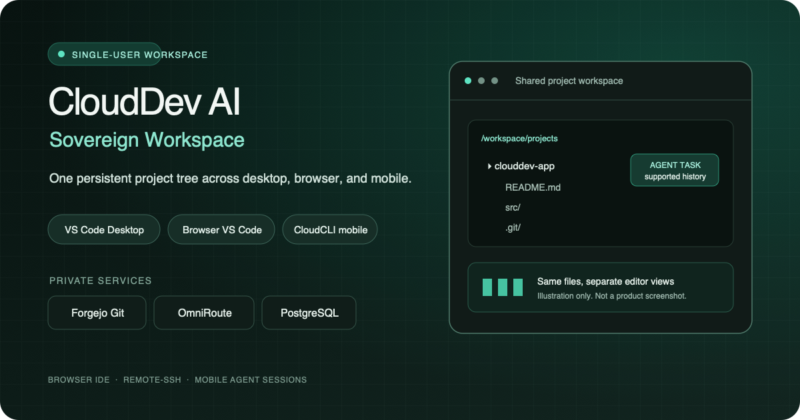
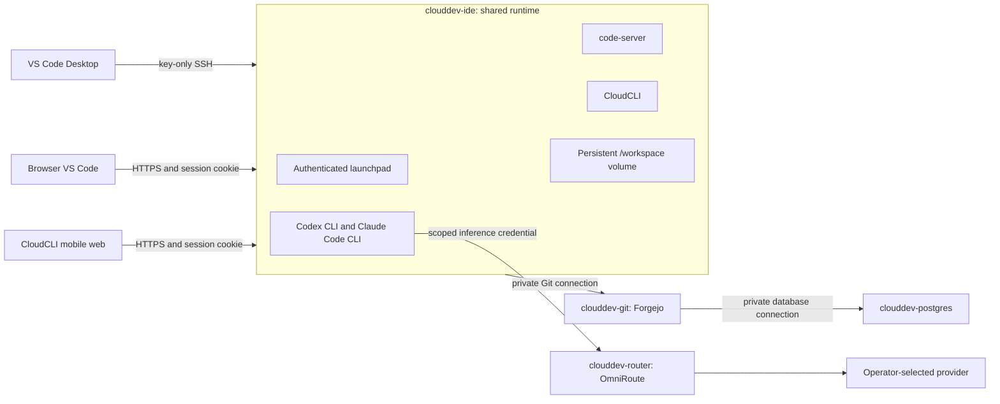

# CloudDev AI: Sovereign Workspace

CloudDev AI gives one developer a persistent workspace on Railway. VS Code
Desktop, the browser IDE, and CloudCLI's mobile web interface connect to the
same persistent project tree and supported agent-session history.

This is a single-user deployment, not a shared SaaS service. Clients share the
filesystem, not editor-window state. A Railway restart stops running processes;
the workspace records interrupted tasks and exposes only provider-supported
resume actions.



This illustration is not a product screenshot. Product captures are shown in the documentation.

**Release status: 16 of 24 gates complete.** The Railway Marketplace release
is not ready. The exact image security gates, fresh Railway deployment,
application-level Railway restore, and parts of the cross-device acceptance remain open. See
[the current release status](docs/operations/RELEASE_STATUS.md) before using
this project beyond local evaluation.

[Documentation](https://schero94.github.io/clouddev-ai-sovereign-workspace/) ·
[Features](docs/features.md) ·
[Provider setup](docs/how-to/providers.md) ·
[Start here](docs/getting-started.md) ·
[Security hold](docs/security/IMAGE_SCAN.md) ·
[License](LICENSE)

## Overview

The workspace service keeps the editor, terminal CLIs, mobile interface, SSH
server, and launchpad together. Forgejo, PostgreSQL, and OmniRoute run as
separate services. Each deployment has its own data and credentials.

The checked-in Railway configuration describes the four services and their
private references. It is not a published Marketplace template. A real template
URL, a verified badge, and a successful fresh-project Railway deployment do
not exist yet. This is not a published or one-click-verified template.

## Verified features

The following features have local test evidence in this repository. Local
checks do not establish that Railway, physical devices, or Marketplace
publication have passed acceptance.

| Capability | Current evidence and boundary |
| --- | --- |
| Shared development workspace | One persistent `/workspace` volume holds projects, home data, editor settings, CLI configuration, and session artifacts. Runtime tests check the mount and unprivileged application processes. |
| Browser and mobile clients | The workspace provides code-server, CloudCLI, and an authenticated launchpad. Local proxy tests cover cookie checks, CloudCLI bearer-token handling, and WebSocket upgrades. Railway HTTPS and physical-device acceptance remain open. |
| Native VS Code connection | An explicit key-only OpenSSH service is configured for Remote-SSH. Local SSH checks pass. The desktop-to-phone-to-desktop flow on a live Railway deployment is not verified. |
| Codex and Claude Code routing | Both CLIs are installed in the workspace. Mock LLM provider tests verify authenticated model listing and request forwarding through OmniRoute without paid API calls. |
| Forgejo Git | A private repository round-trip has been tested with a regular, non-admin user. The test clones, commits, pushes, fetches, and checks data after a local restart. |
| Task recovery | A local restart test verifies that running task records become interrupted and that supported session history remains available. The process itself does not survive a restart and prompts are not replayed automatically. |
| Local service stack | Docker Compose checks cover the IDE, Forgejo, PostgreSQL, and OmniRoute services with local health and persistence checks. This is not a live Railway deployment. |

See [GATES.md](GATES.md) for the evidence and limits behind each result.

## Docker build contexts

The IDE, OmniRoute overlay, and Forgejo application build contexts exclude
repository Markdown, documentation assets, local browser traces, and local
agent state through their `.dockerignore` rules. PostgreSQL uses an upstream
image and has no application build context. These rules only affect future
build inputs. They do not remove files from Git history, purge existing image
layers, or remove files already present in upstream images and dependencies.

The repository has no container-publishing workflow. The expected Docker Hub
repository lookup returned 404, and the current GitHub token could not inspect
Packages because it lacks `read:packages`. An image in an unqueried registry
has not been ruled out. See the [Docker context record](docs/operations/CONTROL_PLANE.md#docker-contexts).

## Architecture



Railway service responsibilities:

- `clouddev-ide` runs code-server, CloudCLI, Codex CLI, Claude Code CLI, Caddy,
  key-only OpenSSH, and the launchpad.
- `clouddev-git` runs rootless Forgejo. Public registration is disabled.
- `clouddev-postgres` stores Forgejo's relational data and has no public domain.
- `clouddev-router` runs the pinned OmniRoute release with persistent SQLite
  state. Keep its listeners private.

The workspace has one Railway volume mounted at `/workspace`. Its subdirectories
hold the user's home, projects, persistent settings, agent state, and task
registry. Railway volume-backed services cannot be horizontally replicated.
See [the architecture guide](docs/architecture.md) for the data paths.

## Quick start

Local development needs Docker Engine with Docker Compose v2. Node.js 24.22 or
later and Python 3.13 with `uv` are needed for the repository and documentation
checks.

```sh
./scripts/dev-env.sh
docker compose config --quiet
docker compose up --build
```

Open `http://localhost:8080/` and sign in with `CODE_SERVER_PASSWORD` from the
local `.env`. Keep `.env`, the local SSH private key, and `secrets/` out of Git.
CloudCLI asks you to create its separate single-user account on first use.
Continue with [first-run onboarding](docs/getting-started.md).

Local HTTP is for development only. Compose exposes the workspace on loopback
port `8080`, Forgejo on `3000`, Forgejo SSH on `2223`, OmniRoute's local
administration dashboard on `20128`, and workspace SSH on `2222`. PostgreSQL
and the OmniRoute inference listener remain on the Compose network.

## Railway deployment

There is no published template to deploy today. Do not treat the configuration
as a production-ready or one-click-verified release. The current image findings
are a release hold, not a warning to click through.

For a maintainer validation deployment, use a new test project in the intended
personal Railway workspace. Never apply an unreviewed plan to an existing
project.

1. Open [release status](docs/operations/RELEASE_STATUS.md) and
   [the image scan and release decision](docs/security/IMAGE_SCAN.md). Stop if
   G15 or G17 is still open.
2. Sign in to Railway with the account that will own the test deployment. In
   the dashboard, create a fresh project in that account. Do not reuse the
   shared business validation project or a production project.
3. In a local checkout, run `npm run check:railway`. Link the Railway CLI to
   only that fresh test project, then run `railway config plan`. Read the whole
   plan and confirm it contains only the four CloudDev services and their
   expected volumes and references before applying anything.
4. Follow the [Template Composer runbook](docs/operations/RAILWAY_MARKETPLACE.md).
   In the Composer, set the requested region to `europe-west4-drams3a`, configure
   the generated HTTPS domains for the workspace and Forgejo, and add TCP
   proxies for their SSH listeners. Keep PostgreSQL and OmniRoute private.
5. In the Composer's variables for each service, add the ten independently
   generated secrets and the operator's Ed25519 public key from the
   [variable inventory](docs/operations/RAILWAY_TEMPLATE_VARIABLES.md). Never
   enter a private SSH key or provider master key there.
6. Check the one-replica setting, volume mounts, health checks, restart policy,
   domain access, and disabled Serverless/App Sleeping setting. Create the
   template draft only after the plan and configuration have been reviewed. In
   Railway, deploy that draft to a second fresh project and run the live auth,
   SSH, persistence, provider, cross-device, and restore checks.
7. After every release gate passes, open the draft's template page in Railway
   and click **Publish**. Railway must provide the real template URL before
   this README can show a deploy button.
8. Deploy the published template to another fresh project and repeat the
   acceptance checks. A source declaration or local test is not a live
   read-back.

The [step-by-step onboarding guide](docs/getting-started.md) describes the
operator's first login. The [Marketplace runbook](docs/operations/RAILWAY_MARKETPLACE.md)
has the full publication sequence and current Railway links.

## First-run onboarding

After a deployment is available for testing:

1. Open the generated workspace HTTPS domain. Sign in with the generated
   `CODE_SERVER_PASSWORD`, then save it in a password manager and seal or remove
   the bootstrap variable as the runbook directs.
2. Open the launchpad. Choose Browser VS Code or CloudCLI. On first use, create
   CloudCLI's separate local account.
3. Open the Forgejo domain. Sign in with the generated bootstrap administrator
   password, change it, and create a regular user with a private repository.
4. In a workspace terminal, run `git-setup`. Add the displayed public key to
   the regular Forgejo user. Clone the private repository. The workspace keeps
   the matching private key; do not use the Forgejo administrator token for Git.
5. From the launchpad, open OmniRoute. Sign in with its generated first-login
   password, change it, add your provider in the authenticated dashboard, and
   create a restricted inference API key.
6. In the workspace terminal, run `ai-setup`. Select a model returned by
   `ai-models`, then check the connection with `ai-status`.
7. Run `ai-codex` or `ai-claude` in the project terminal. These commands use
   the configured OmniRoute endpoint and scoped inference key.
8. For desktop access, add the workspace TCP proxy host and port to VS Code's
   Remote-SSH configuration and authenticate with the operator's private key.
   On a phone, open CloudCLI in the browser and sign in to its own account.
   Both clients use the same files. The editor windows do not share UI state.

See [the onboarding guide](docs/getting-started.md) for connection details and
recovery behavior. The launchpad opens services and provides commands. It does
not run agent commands on the user's behalf.

## Provider routing and billing

The workspace wrappers send Codex CLI and Claude Code CLI requests to
OmniRoute. OmniRoute authenticates the request with a scoped inference key and
routes it to a provider connection configured by the owner. The available
providers and models depend on the pinned OmniRoute release and the owner's
credentials. This is not a promise that every provider or model works.

### ChatGPT subscription and OpenAI API are different

A ChatGPT subscription does not include OpenAI API credits. `ai-codex` is
configured to use the OmniRoute API endpoint and its scoped key; it does not
convert a consumer ChatGPT plan into API usage. OpenAI API requests require
provider API access and are billed under the current API terms and rates. Do not copy browser
cookies, extract subscription tokens, or assume that a separate Codex sign-in
uses OmniRoute.

### DeepSeek and free-model options

To use DeepSeek through OmniRoute, configure your own DeepSeek API account and
API key in OmniRoute, then select a model visible to the scoped workspace key.
Check [DeepSeek's current API documentation and pricing](https://api-docs.deepseek.com/quick_start/pricing)
before sending requests. A free consumer chat surface does not make API traffic
free.

Free model and provider availability, access rules, rate limits, data handling,
and terms are controlled by those providers and can change. Check the live list
with `ai-models` and
review the provider's terms before sending source code or other sensitive data.
Fallback routing must respect provider terms, rate limits, and quotas. It is not
a way to evade usage limits or billing rules.

Provider master keys stay in OmniRoute. The agent needs a scoped inference key
to make routed requests, so code executed by that agent can use the permissions
of that key. See the [provider onboarding guide](docs/operations/RAILWAY_TEMPLATE_VARIABLES.md#provider-setup-after-deployment)
and [data flow notes](docs/privacy/DATA_FLOW.md).

## Security boundaries

CloudDev AI is designed for one operator per deployment. Browser entry points
use an authenticated workspace cookie. Workspace SSH accepts configured public
keys and rejects password authentication. Forgejo and OmniRoute keep their own
accounts; there is no implicit cross-service SSO.

Agents run as the workspace user. They can read and change that user's project
files and can access the restricted Git and inference credentials needed for
work. Untrusted repository content and commands can use those same permissions
and can make outbound Internet connections. Railway private networking does
not filter outbound traffic.

The workspace process does not receive a Railway token, Forgejo administrator
token, OmniRoute management secret, provider master key, Docker socket, or
privileged container access. Repository scripts are not automatically run when
cloning. These controls reduce exposure; they do not sandbox arbitrary code
from the workspace user.

**Release hold:** local scans found unresolved critical and high severity
findings in the pinned service images. G15 and G17 remain open. Do not call the
images clean, publish the template as verified, or expose OmniRoute's dashboard
or inference listeners publicly until the exact release images have been
reviewed and the release gates pass. See the detailed
[image scan](docs/security/IMAGE_SCAN.md), [threat model](docs/security/THREAT_MODEL.md),
and [hardening guide](docs/security/SECURITY_HARDENING.md).

## Privacy and data flows

Project files, editor settings, CLI configuration, CloudCLI session metadata,
and task state persist on the workspace volume. Forgejo uses its own volume and
PostgreSQL. OmniRoute stores provider configuration and usage data in its
persistent SQLite store. Prompts, relevant project context, and tool output
sent to a provider are processed under that provider's terms.

Selecting Railway EU West does not establish EU-only processing. AI providers
may process data outside the Railway region. Retention, training use, transfer
terms, and legal obligations depend on the provider, model, and operator's
account. This project does not claim automatic GDPR compliance or legal review.

Read [the data-flow map](docs/privacy/DATA_FLOW.md),
[GDPR readiness notes](docs/privacy/GDPR_READINESS.md),
[subprocessor inventory](docs/privacy/SUBPROCESSORS.md), and
[DPA checklist](docs/privacy/DPA_CHECKLIST.md).

## Backup and restore

The local backup command streams the workspace, Forgejo volume, PostgreSQL
database and role dumps, and OmniRoute SQLite snapshot through `age` to an
operator-controlled public recipient. It writes no plaintext archive to the
backup destination. OmniRoute's consistent SQLite snapshot exists briefly in
the router container's `/dev/shm` tmpfs while it is exported. The matching
private identity stays outside Railway, this repository, `/workspace`, and
agent environments. Keep OmniRoute's
`STORAGE_ENCRYPTION_KEY` separately. Railway's volume snapshots remain
provider-managed and are not encrypted with this operator key.

Before an export, stop agent tasks and other workspace or Git writes, then
acknowledge that check explicitly:

```sh
AGE_RECIPIENT='age1...your-public-recipient' \
  bash scripts/backup-encrypted.sh --acknowledge-quiesced \
  '/path/to/new-encrypted-backup'
```

The local automated restore drill passed for all four stores in a separately
named Compose project. It used an ephemeral test identity and marker data. That
does not prove an application-level login or provider reconnection after a
Railway restore. Follow [the backup and restore procedure](docs/security/BACKUP_RESTORE.md)
and retain the full restore evidence in [GATES.md](GATES.md).

## Updates

1. Review upstream release notes, security advisories, and license changes.
2. Back up all state stores and verify that the backup can be read.
3. Change one pinned image or CLI dependency at a time in a separate test
   project. Rebuild, run tests, and scan the exact candidate images.
4. Check the complete Railway plan and verify variables, private networking,
   public domains, TCP proxies, volumes, replica counts, and sleep settings.
5. Run the provider mock tests, Git round-trip, auth checks, cross-device
   acceptance, and an isolated restore before updating production.
6. Rotate provider credentials in OmniRoute. Create a replacement scoped
   inference key, run `ai-setup`, test it, then revoke the old key.

Volume-backed services run as a single replica and may have downtime during a
restart. Do not update a live volume or database without a tested backup and
recovery plan.

## Troubleshooting

- **Remote-SSH fails:** check the Railway TCP proxy host and port, confirm
  `SSH_AUTHORIZED_KEYS` contains your public key, and keep the matching private
  key on your device. `railway ssh` is not the VS Code Remote-SSH transport.
- **No model appears:** open OmniRoute through the authenticated workspace,
  verify the provider connection, create or rotate a scoped inference key, then
  run `ai-setup` and `ai-models`.
- **A task is interrupted:** inspect `clouddev-tasks list` and CloudCLI's
  sessions. Restarted processes do not continue in the background. Resume only
  through a session mechanism supported by the upstream agent.
- **The Composer differs from IaC:** compare every `preserve()` value with the
  [template variable inventory](docs/operations/RAILWAY_TEMPLATE_VARIABLES.md).
  `preserve()` keeps an existing value; the Composer must generate secrets for
  new template deployments.
- **A restore test fails:** leave the source volumes untouched, restore to an
  isolated target, and include OmniRoute's encryption key. Follow the
  [four-store restore guide](docs/security/BACKUP_RESTORE.md).

See the full [troubleshooting guide](docs/operations/TROUBLESHOOTING.md).

## Costs and capacity

| Cost item | Evidence or estimate |
| --- | --- |
| Idle and single-agent resource use | Not measured in this repository. No RAM, CPU, or storage benchmark is claimed. |
| Railway infrastructure | No total price estimate is published. The bill depends on the selected plan, always-on compute, volume use, network egress, and current Railway rates. |
| AI usage | Billed separately by the provider account used in OmniRoute. API prices and free-model policies can change. |
| Longer agent sessions | Large contexts and tool outputs can increase memory use and provider token consumption. The increase has not been benchmarked here. |

The workspace is configured not to sleep. That is required for availability,
but means operators should budget for an always-on service. Check Railway's
current pricing and each provider's rates before deployment.

## Upstream licenses

CloudDev AI's own code is MIT-licensed. The runtime includes upstream software
with separate licenses and terms, including CloudCLI (AGPL-3.0-or-later),
OmniRoute (MIT), code-server (MIT), Forgejo (GPL-3.0-or-later), Codex CLI
(Apache-2.0), and Claude Code (Anthropic terms). The full pinned component and
license list is in [UPSTREAM_LICENSES.md](docs/operations/UPSTREAM_LICENSES.md).
Claude Code is not relicensed by this repository's MIT license.

## Release status

This source snapshot reports **16 of 24 acceptance gates complete**. Local
Compose, mock-provider, Git, and security checks are not substitutes for the
open live gates. G4 and G5 still need full cross-device evidence; G12 needs a
fresh Railway deployment; G13 proves a local four-store data-level restore but
not Railway recovery; G14 needs a published and test-deployed Marketplace
template. G15/G17 are the image security release hold. G20/G23 remain open
until the current docs publish and the GitHub social preview is uploaded. G24
passed an isolated application-level restore, while CloudCLI session resume
remains unverified.

Read the generated [release status](docs/operations/RELEASE_STATUS.md) and
[acceptance ledger](GATES.md). The Marketplace template is not published, and
no Railway template ID or verified badge is claimed.

## Railway deploy button

There is no button here because Railway has not assigned a published template
URL. The button must use the exact URL Railway returns after publication. Do
not use a placeholder template ID. Follow the
[Marketplace release runbook](docs/operations/RAILWAY_MARKETPLACE.md) after the
security and deployment gates are closed.

## Changelog

### Unreleased

- The repository contains a single-user workspace runtime, persistent storage
  configuration, private Forgejo and PostgreSQL services, and an OmniRoute
  service definition.
- Local tests cover mock Codex and Claude routing, private Git operations,
  authentication checks, and task/session recovery behavior.
- Railway publication and the security release hold remain open. See the
  [release status](docs/operations/RELEASE_STATUS.md) for current evidence.
