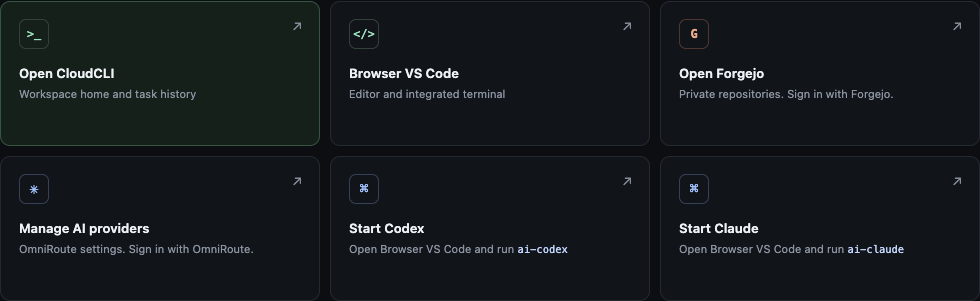
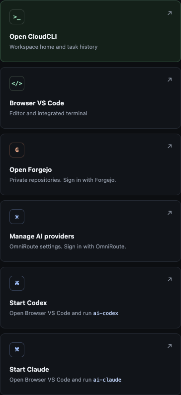

 SINGLE-USER WORKSPACE / ONE PERSISTENT PROJECT TREE

# One workspace.  Every screen. {.cd-home-title}

Move between VS Code Desktop, browser VS Code, and CloudCLI on your phone. They work with the same persistent projects and supported agent-session artifacts.

[See how deployment works](how-to/deploy-on-railway.md){ .cd-button .cd-button--primary }
[Explore the features](features.md){ .cd-button .cd-button--quiet }

Editor windows do not share UI state. A workspace restart stops running processes. Review interrupted tasks and resume only through a provider-supported action.

ONE REMOTE WORKSPACETHREE CLIENTS

VS<strong>VS Code Desktop</strong><small>Key-only Remote-SSH</small>

&lt;/&gt;<strong>Browser IDE</strong><small>code-server</small>

C<strong>CloudCLI mobile</strong><small>Phone and tablet</small>

<small>PERSISTENT WORKSPACE VOLUME</small><strong>/workspace</strong>projects <i></i> Git checkouts <i></i> session artifacts

ONE USERONE PROJECT TREEPRIVATE INSTANCE

↗

<strong>Railway release status</strong> No live Railway template or verified one-click deployment is available yet. Check the open gates before using this as a production deployment guide.

[Review release evidence](operations/RELEASE_STATUS.md){ .cd-inline-link }

<section class="cd-visual-section" aria-labelledby="cd-launchpad-heading">

THE WORKSPACE LAUNCHPAD

<h2 id="cd-launchpad-heading">A clear starting point on desktop and phone</h2>

The images below are from the local launchpad build. They show the real service cards, not a live Railway deployment.

<figure class="cd-screenshot cd-screenshot--desktop">

<figcaption><strong>Desktop launchpad</strong>Captured from the local build. Each destination uses its own service sign-in where required.</figcaption>
</figure>
<figure class="cd-screenshot cd-screenshot--mobile">

<figcaption><strong>Mobile layout</strong>The same launchpad actions fit a phone screen.</figcaption>
</figure>

The captures document the local interface only. Railway domains, service health, Remote-SSH, and Marketplace publication still require live acceptance checks.

</section>

<h2 class="cd-section-title">Choose a path START HERE</h2>

01 CAPABILITIES

## See what is included
Review the workspace surfaces, persistent data, provider routing, and the limits that still apply.

[Open the feature list](features.md){ .cd-route-card__link }

02 DEPLOY

## Prepare a Railway project
Follow the Composer steps and distinguish the documented setup from a verified live template.

[Read the Railway guide](how-to/deploy-on-railway.md){ .cd-route-card__link }

03 FIRST RUN

## Sign in and finish setup
Use the generated workspace password, create regular service accounts, and connect your own provider.

[Follow first login](how-to/first-login.md){ .cd-route-card__link }

04 DEVICES

## Connect your clients
Set up key-only Remote-SSH, browser VS Code, and the CloudCLI mobile interface.

[Connect desktop and mobile](how-to/connect-clients.md){ .cd-route-card__link }

More detail: [local quick start](getting-started.md), [architecture](architecture.md), and the [operations control plane](operations/CONTROL_PLANE.md).

BUILT AROUND CLEAR BOUNDARIES

## Private workspace, defined limits
Provider master keys stay in OmniRoute. Agent processes can read the scoped inference key they use and can make outbound connections. Railway Private Networking does not filter that egress. A restart interrupts running work; supported session recovery is manual.

[Security hardening](security/SECURITY_HARDENING.md){ .cd-guardrail-link }
[Data flows](privacy/DATA_FLOW.md){ .cd-guardrail-link }
[Backup and restore](security/BACKUP_RESTORE.md){ .cd-guardrail-link }

Source, tests, and release evidence live in the <a href="https://github.com/Schero94/clouddev-ai-sovereign-workspace">GitHub repository</a>.

