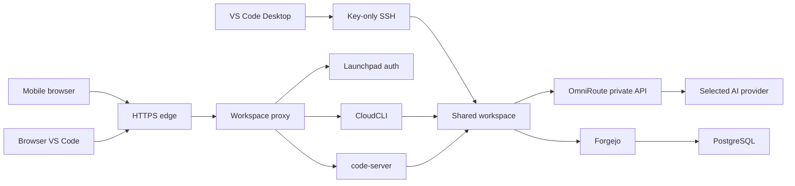

# CloudDev AI threat model

## Executive summary

CloudDev AI is a single-operator cloud workspace. Its largest risks are theft
of workspace or Git credentials, malicious repository content executing with
the workspace user's permissions, outbound data transfer from an agent, and
unverified upstream dependencies in the public OmniRoute dashboard. The local
runtime has separate browser-cookie and SSH-key entry points, but it is not a
sandbox for hostile code. The OmniRoute image uses a pinned release whose
Next.js version is within published advisory ranges. Some affected features
are disabled or mitigated in the upstream build, but the Marketplace release
gate remains open until the image is rebuilt or replaced with a fully verified
patched release.

## Scope and assumptions

In scope are the root Docker Compose stack, `.railway/railway.ts`, the shared
workspace service, the launchpad auth gateway, Forgejo, PostgreSQL, OmniRoute,
and their tests and security documentation. The intended production shape is
one isolated Railway project per operator. No live Railway project, public
domain, or Marketplace template is linked to this checkout. Compose uses
loopback HTTP for local testing. Railway HTTPS, domain rules, generated secret
values, and TCP proxy endpoints still require a fresh-project read-back.

Assumptions that affect this model:

- The operator is the only human with an account in the deployment. The model
  does not cover adding a second shell user.
- Browser traffic reaches the workspace through Railway HTTPS. Forgejo and
  OmniRoute retain their own sign-in systems.
- The operator-provisioned SSH private key remains on the desktop client. Its
  public key is installed as a root-owned file outside `/workspace`.
- A coding agent may run arbitrary shell commands, read files available to UID
  1000, and make outbound network requests. Railway private networking does
  not restrict egress.
- Provider API use can send prompts, source excerpts, tool output, and other
  context to the selected provider. Provider location and retention depend on
  the account and terms the operator selects.
- Backup restore, physical phone acceptance, Windows Remote-SSH, and a fresh
  Railway deploy have not been proven by this local model.

Questions that would change risk rankings include the sensitivity of project
data, provider contracts and retention, the operator's chosen public domains,
and whether the deployment will be used from untrusted networks or shared with
another person.

## System model

### Primary components

- `clouddev-ide` combines code-server, CloudCLI, the launchpad, Codex CLI,
  Claude Code CLI, Caddy, and key-only OpenSSH. The application processes run
  under distinct service UIDs except CloudCLI, code-server, and agents, which
  share UID 1000.
- One volume at `/workspace` contains the persistent home, projects, agent
  configuration, task registry, and CloudCLI database. The mount root is
  root-owned and traversable. Home and project directories remain owned by
  `coder`.
- The launchpad runs as UID 1002. It issues the browser session cookie, checks
  Caddy's loopback forward-auth request, and exposes only public service
  status, the SSH fingerprint, and aggregate recovery counts.
- `clouddev-git` runs Forgejo with registration disabled, private repositories
  by default, and PostgreSQL for its relational state. Its Git SSH service is
  separate from the workspace shell.
- `clouddev-postgres` has no public listener.
- `clouddev-router` is an upstream OmniRoute 3.8.52 image pinned by digest,
  wrapped to include the local health probe. It stores encrypted provider
  configuration in a persistent SQLite volume. The inference port remains
  private and requires an API key.
- Railway's edge provides public HTTPS. Railway TCP Proxy provides explicit
  TCP endpoints for workspace SSH and optional Forgejo Git SSH.

### Data flows and trust boundaries

- Browser -> Railway HTTPS -> Caddy: workspace cookie, UI requests, project
  content, and CloudCLI Bearer token. Caddy verifies the signed cookie through
  the loopback launchpad. `forward_auth` uses a separate derived internal key
  and does not replace the request's `Authorization` header. The sign-in form
  checks the request origin and redirects only to local paths.
- Caddy -> CloudCLI and code-server: HTTP over loopback. The internal
  listeners have no public domain or Compose host mapping. CloudCLI's own
  account/JWT remains an application-level check for its API.
- Caddy -> launchpad: HTTP over loopback. Caddy can call the private
  `/auth/verify` route. The route rejects requests without the internal key.
  The launchpad process receives the workspace password and signing secret;
  it runs as UID 1002, separately from UID 1000 agents.
- Native VS Code -> Railway TCP Proxy -> sshd: SSH with a user-provisioned
  Ed25519 key and the persistent host-key fingerprint. sshd rejects password,
  keyboard-interactive, root, agent, X11, tunnel, and remote-forwarding access.
  Local forwarding is limited to loopback for Remote-SSH.
- Agent -> `/workspace`: ordinary filesystem access as UID 1000. A process can
  read or change every file available to the workspace user, including the
  restricted gateway key and Forgejo Git private key needed for work.
- Agent -> OmniRoute inference API: private-network HTTP with a scoped API key.
  OmniRoute forwards model requests to the chosen provider. The workspace has
  no provider master key. The API endpoint is not public; egress from the
  workspace is not filtered.
- Workspace -> Forgejo: HTTPS or SSH with a regular account's Git identity.
  The Forgejo administrator token is not in the IDE environment.
- Forgejo -> PostgreSQL: private service traffic with a least-privilege
  application role. PostgreSQL has no public domain.
- Railway operator -> service variables and Composer: deployment credentials,
  generated service secrets, domain and TCP proxy configuration. A Railway
  project token is not passed to workspace processes.

#### Diagram

## Assets and security objectives

| Asset | Why it matters | Security objective |
| --- | --- | --- |
| Project files and Git working trees | Source, credentials accidentally stored by the operator, and work product | C, I, A |
| Workspace SSH private key on desktop | Grants a shell in the user's persistent workspace | C, I |
| Workspace SSH host private key | Authenticates the persistent host across restarts | I |
| Workspace password and cookie secret | Authorize browser access to the workspace | C, I |
| CloudCLI account JWT and session database | Authorize agent sessions and preserve history | C, I, A |
| Restricted OmniRoute inference key | Enables billable requests through configured models | C, A |
| Forgejo Git private key and account | Enables repository fetch and push | C, I |
| Forgejo admin password and database role | Controls forge and Git data | C, I, A |
| OmniRoute provider credentials and encryption key | Control AI providers and encrypted database recovery | C, I, A |
| Task registry and provider transcripts | Support status and user-initiated recovery after restarts | I, A |
| Backup archives and Railway secrets | Restore all state and regain service control | C, I, A |

C, I, and A denote confidentiality, integrity, and availability.

## Attacker model

### Capabilities

- A remote attacker can probe public browser endpoints, Forgejo, OmniRoute's
  dashboard, and the workspace SSH TCP proxy.
- An attacker who steals the workspace password or browser session can use the
  workspace web interfaces until the credential or session is revoked.
- An attacker who obtains the operator's SSH private key can access the
  workspace shell as `coder`.
- A malicious repository or prompt can cause an authorized agent to execute
  commands, inspect accessible files, alter projects, and make outbound
  requests.
- A compromised browser origin can act with the victim's workspace session.
- A bad update or unpatched upstream package can expose a public service or
  break session recovery.

### Non-capabilities

- There is no shared multi-tenant workspace or cross-project user boundary in
  this deployment model.
- An ordinary workspace agent does not run as root and receives no Docker
  socket, Railway token, Forgejo administrator token, or provider master key.
- Railway's private network is not an egress sandbox and must not be modeled
  as one.
- A persistent volume does not preserve in-memory processes or guarantee an
  active agent task survives a Railway restart.

## Entry points and attack surfaces

| Surface | How reached | Trust boundary | Notes | Evidence |
| --- | --- | --- | --- | --- |
| Workspace cookie login | Public HTTPS `/auth/login` | Internet to launchpad auth | Origin checked, rate-limited, signed cookie | `services/launchpad/src/workspace-auth.mjs:createWorkspaceAuth` |
| Workspace UI routes | HTTPS `/`, `/vscode/`, `/launchpad/` | Internet to Caddy and loopback upstreams | Forward-auth cookie check; `/healthz` is generic liveness | `services/ide/Caddyfile.template` |
| Workspace SSH | Railway TCP proxy to 2222 | Internet to sshd | Ed25519 only; host fingerprint is persistent | `services/ide/sshd_config`, `services/ide/src/install-authorized-keys.mjs` |
| Forgejo web and API | Public HTTPS domain | Internet to Forgejo login | Registration disabled; repository access requires login | `services/forgejo/entrypoint.sh` |
| Forgejo Git SSH | Optional TCP proxy to 2222 | Internet to Forgejo SSH | Git-only identity; distinct proxy from workspace SSH | `docker-compose.yml`, `services/forgejo/entrypoint.sh` |
| OmniRoute dashboard | Workspace HTTPS `/omniroute/` path | Internet through workspace cookie gate, then OmniRoute native login | Upstream application and dependency risk remains | `services/ide/Caddyfile.template`, `services/omniroute/Dockerfile` |
| OmniRoute inference API | Private dashboard port 20128 through the workspace loopback adapter | Workspace and router | Requires a scoped key; only the adapter is reachable by agents | `services/ide/Caddyfile.template`, `services/omniroute/README.md` |
| Agent filesystem and shell | SSH, code-server terminal, CloudCLI | UID 1000 to persistent workspace | Untrusted tasks run as the workspace user | `services/ide/src/service-environment.mjs`, `services/ide/src/terminal-agent.mjs` |
| Railway Composer and variables | Operator dashboard | Operator to control plane | Domains, secret generators, and live sleep state require Composer/read-back | `.railway/README.md` |

## Top abuse paths

1. A remote attacker obtains the workspace password through phishing or a
   compromised device, signs in, then reads or changes projects through
   CloudCLI or browser VS Code.
2. A device backup or terminal log leaks the operator SSH private key. An
   attacker connects through the public TCP proxy and gains the workspace
   user's filesystem and shell permissions.
3. A malicious repository instruction persuades an agent to inspect its
   workspace. The agent reads the scoped inference and Git keys, then uses
   outbound HTTPS to exfiltrate them or push malicious changes.
4. A malicious commit or extension exploits the shared UID 1000 process
   boundary. The attacker changes projects, configuration, shell startup
   files, or other state accessible to the workspace account.
5. A vulnerable or unauthenticated OmniRoute dashboard route is exposed on a
   generated public domain. An attacker exploits upstream framework code or
   steals the operator's OmniRoute session and changes provider/API-key state.
6. A provider or external integration returns malicious content. CloudCLI,
   OmniRoute, or an agent processes it, causing script injection or command
   execution with the privileges of that component.
7. A Railway restart terminates a long-running agent process. If the operator
   assumes the process continued and blindly replays the prompt, it can cause
   duplicate or conflicting changes.
8. The operator loses a volume or encryption key and discovers that no
   off-project restore was tested. Git, workspace, database, or provider state
   becomes unavailable.

## Threat model table

| Threat ID | Threat source | Prerequisites | Threat action | Impact | Impacted assets | Existing controls (evidence) | Gaps | Recommended mitigations | Detection ideas | Likelihood | Impact severity | Priority |
| --- | --- | --- | --- | --- | --- | --- | --- | --- | --- | --- | --- | --- |
| TM-001 | Internet attacker or stolen browser device | Workspace password or cookie is obtained | Uses browser routes to inspect, change, or delete workspace data | Full access to the single operator's workspace | Files, sessions, Git key, inference key | Launchpad signs 8-hour HttpOnly SameSite cookies; production sets Secure; login checks Origin; `Caddyfile.template` gates UI routes | No MFA; password rotation and cookie revocation need operator action | Use a password manager, rotate password and `CLOUDDEV_WORKSPACE_AUTH_SECRET` after exposure, keep public TLS enabled, consider IP/VPN restrictions | Alert on unusual login attempts and edge access spikes; current app emits no password or prompt logs | Medium | High | high |
| TM-002 | Attacker with stolen operator SSH key | Private key file or its backup is exposed | Connects to public workspace TCP proxy and obtains a shell as `coder` | Reads/changes all workspace data and can use scoped tokens | Workspace files, session history, Git and inference credentials | Root-owned key list outside the volume; key-only sshd; persistent host fingerprint; local verifier compares fingerprint | Key is generated without passphrase by the local helper; no MFA on SSH | Protect desktop key with OS keychain/passphrase, rotate authorized keys, verify host fingerprint through trusted HTTPS | Record SSH auth failures and rotate after unknown fingerprints | Low to medium | High | high |
| TM-003 | Malicious repo content or prompt | Operator runs an agent on the content | Agent reads accessible secrets, alters Git state, or makes outbound requests | Source theft, malicious push, provider spend | Projects, inference key, Git key, cloud data | Agents run without capabilities as UID 1000; admin secrets are excluded; no Docker socket; scripts are not auto-run on clone | Same UID means mode 0600 does not protect keys from the agent; no egress enforcement | Treat repo content as code, review diffs, restrict inference key models, avoid storing credentials in projects, use a real egress policy if required | Review Git audit/activity logs and provider usage anomalies | High | High | high |
| TM-004 | Malicious or compromised browser script | A same-origin XSS or compromised browser dependency | Reads user-visible project data or performs authenticated actions | Workspace confidentiality or integrity loss | Browser session, project data | Cookie HttpOnly, CSP on launchpad, no browser-delivered secrets in the launchpad | Upstream CloudCLI and OmniRoute frontends have independent dependency and XSS risk | Keep upstreams patched; audit rendered Markdown/HTML and extension policies; maintain CSP and dependency scans | Monitor upstream advisories and browser errors | Medium | High | high |
| TM-005 | Upstream OmniRoute vulnerability | Public dashboard domain is enabled and vulnerable feature reachable | Exploits vulnerable Next.js/image route or sanitizer behavior | Router compromise or dashboard session compromise | Provider credentials, inference keys, SQLite data, prompts | Base image is digest-pinned; `sharp` 0.35.5 is present; upstream config sets images unoptimized, disallows SVG optimization, and disables cache components | Image's Next.js 16.3.8 is within published advisory ranges. A runtime-only override to 16.4.3 failed because its prebuilt artifacts did not match. This does not count as a patch. | Keep release blocked until upstream publishes a patched image or a full-source rebuild has updated dependencies and passes health, auth, inference, and dependency checks | Track Next.js and OmniRoute advisories; compare image/package versions during release | Medium | Critical | high |
| TM-006 | Unauthenticated browser/API caller | A route bypasses the Caddy cookie gate or an application auth check | Reaches CloudCLI, code-server, Forgejo, or inference without valid auth | Unauthorized sessions, Git access, or provider use | CloudCLI DB, private repositories, inference API | Caddy cookie forward-auth; SSH public key; Forgejo requires sign-in; OmniRoute inference requires API key; local tests check 401/302 | Live Composer domains and edge/TCP behavior are unverified | Keep all browser domains behind the intended service auth, keep inference private, read back domains/TCP proxies after deployment | Run unauthenticated route probes on every deploy | Low to medium | High | high |
| TM-007 | Railway process restart or volume fault | Active work or unverified backup state | Stops in-memory task or loses a volume/database | Interrupted work or unrecoverable state | Workspace, Git, session history, router config | Persistent volumes; registry marks running jobs interrupted; no auto-replay; backups are documented | Live restart, recovery, and restore drills remain open | Snapshot/backup each store, run isolated restores, resume only from provider-supported history | Alert on interrupted task counts and backup failures | Medium | High | high |
| TM-008 | External AI provider or network recipient | Agent sends project context or provider receives prompt | Retains, trains on, or transfers submitted content under its own policy | Data transfer outside Railway EU West | Source, prompts, personal or confidential data | Operator chooses provider; logs minimize prompt capture; provider master key remains in OmniRoute | Provider region, retention, and legal terms vary; egress is not filtered | Review provider terms/DPA and data residency, minimize prompts, do not send regulated data without approval | Review provider dashboards and contract changes | Medium | High | high |
| TM-009 | Operator configuration error | Composer enables a wrong domain, public port, or sleep setting | Exposes a service, breaks client access, or stops the workspace | Unauthorized access or availability loss | All services and persistent data | IaC declares EU West, volumes, one replica, and no sleep; README lists Composer settings | No live Railway project/read-back exists | Use a fresh test project, review the plan, verify every domain, port, volume, region, and sleep flag | Keep a release checklist and deployment read-back | Medium | High | high |
| TM-010 | Malicious browser request or automation | Agent or attacker can reach workspace public routes | Attempts CSRF against cookie-authenticated login/logout or UI | Session confusion or unwanted logout | Workspace cookie and UI | Strict SameSite cookie; login POST checks same-origin; logout checks same-origin; URL redirects are restricted | Cookie/auth routes have local unit tests, but browser/production HTTPS acceptance remains incomplete | Keep origin checks and add end-to-end auth tests over Railway HTTPS | Monitor auth failures and verify cookie flags from a clean browser | Low | Medium | medium |

## Criticality calibration

- **Critical:** an unauthenticated public route can execute code in the OmniRoute
  container; a leaked provider master key grants broad provider account access.
- **High:** a stolen workspace SSH key permits full access to the single
  operator's workspace; an agent exfiltrates a scoped inference key or pushes
  malicious repository changes.
- **Medium:** a Railway restart interrupts a task but persistent files remain;
  a provider retains submitted code under its own policy.
- **Low:** an unauthenticated health endpoint reveals only that a service is
  alive; a stale non-secret SSH fingerprint display causes a failed first
  connection without granting access.

These ratings assume one operator, public browser/SSH endpoints, private
service networking, and no egress firewall. The OmniRoute dependency threat is
release-blocking because it affects a public dashboard service; exploitability
of each advisory depends on the corresponding upstream route and feature.

## Focus paths for security review

| Path | Why it matters | Related Threat IDs |
| --- | --- | --- |
| `services/ide/entrypoint.sh` | Creates service identities, mount permissions, host keys, and sanitized environments | TM-002, TM-003, TM-009 |
| `services/ide/sshd_config` | Defines public SSH authentication and forwarding policy | TM-002 |
| `services/ide/Caddyfile.template` | Defines cookie forward-auth coverage and browser routing | TM-001, TM-006 |
| `services/launchpad/src/workspace-auth.mjs` | Validates password, origin, signed cookie, redirects, and Caddy auth checks | TM-001, TM-010 |
| `services/ide/src/service-environment.mjs` | Controls which secrets each isolated UID receives | TM-001, TM-003 |
| `services/ide/src/terminal-agent.mjs` | Starts detached provider tasks under the workspace identity | TM-003, TM-007 |
| `services/ide/src/task-registry.mjs` | Persists minimal task state and recovery transitions | TM-007 |
| `services/forgejo/entrypoint.sh` | Provisions PostgreSQL role and first administrator; disables registration | TM-006, TM-009 |
| `services/omniroute/Dockerfile` | Pins the upstream router base image and health behavior | TM-005 |
| `.railway/railway.ts` | Declares regions, volumes, ports, replicas, references, and no-sleep behavior | TM-009 |

## Notes on use

- Entry points covered: browser cookie login and UI routes, workspace SSH,
  Forgejo web/API/Git SSH, OmniRoute dashboard/inference, private PostgreSQL,
  agent shell/filesystem, and Railway Composer.
- Trust boundaries covered: public edge, cookie gateway, SSH, service UIDs,
  private networking, provider APIs, persistent storage, and operator control
  plane.
- Runtime, local Compose, IaC, and unverified live Railway settings are
  distinguished. No live deployment or restore is claimed.
- The pinned router source has specific upstream mitigation settings, but no
  patched full-image rebuild or public production auth test has completed.
